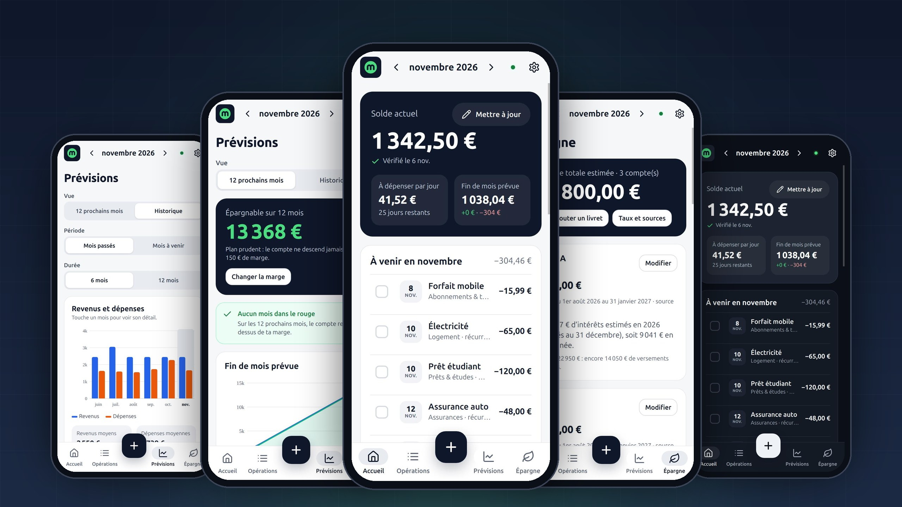
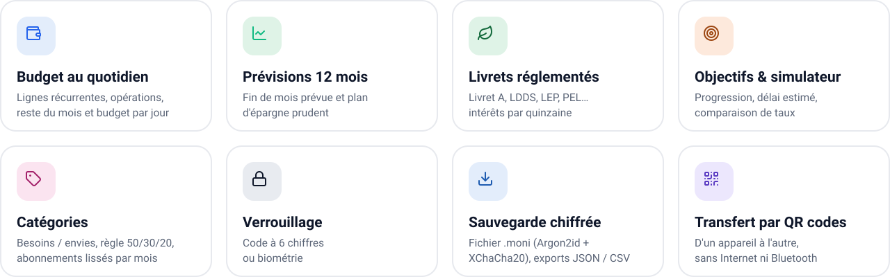
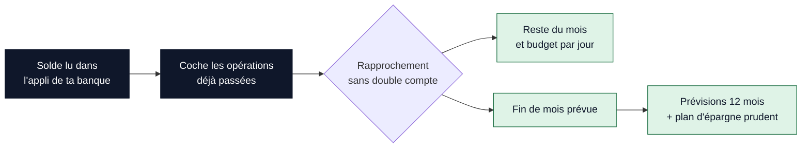
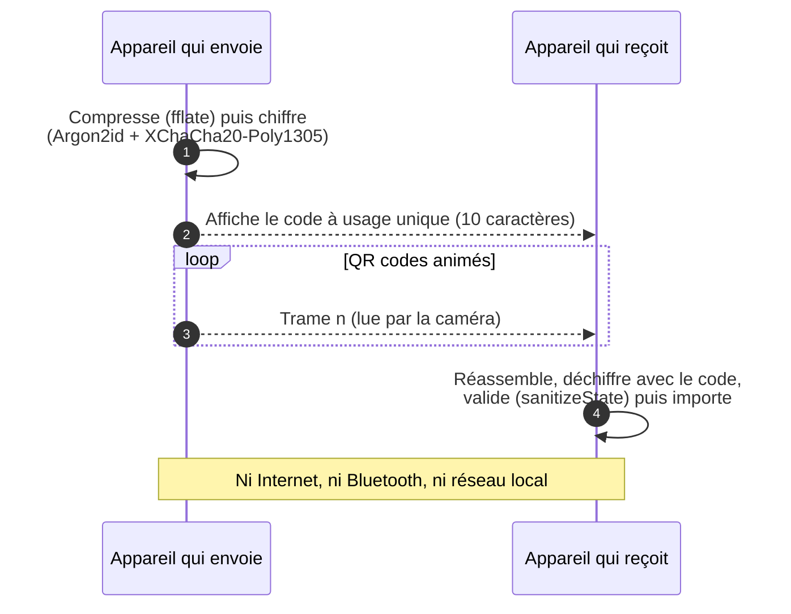
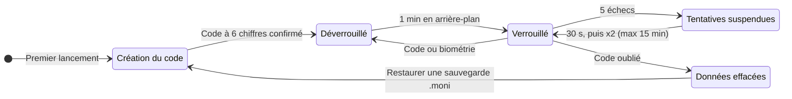
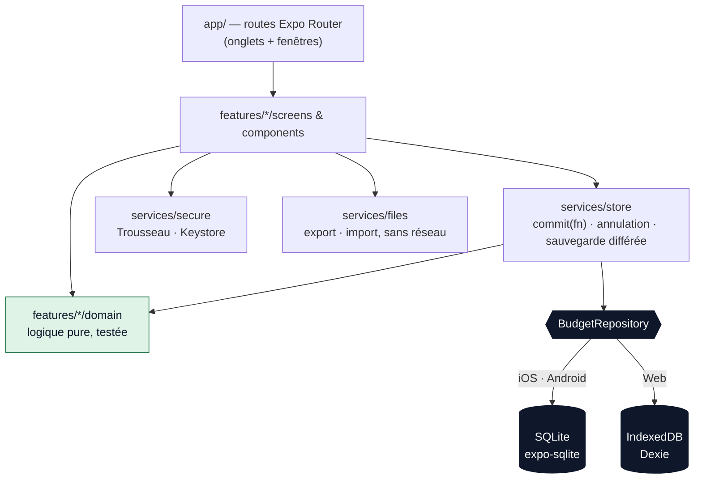

<h3 align="center">Gestion de budget personnel, privée par conception.</h3>

<p align="center">
  Pas de compte, pas de serveur, pas de traceur.<br />
  Tes revenus, tes dépenses et ton épargne restent sur ton appareil.
</p>

<p align="center">
  <a href="#presentation"><strong>Présentation</strong></a>&nbsp;&nbsp;·&nbsp;&nbsp;
  <a href="#mentions-legales"><strong>Mentions légales</strong></a>&nbsp;&nbsp;·&nbsp;&nbsp;
  <a href="#roles"><strong>Rôles et autorisations</strong></a>&nbsp;&nbsp;·&nbsp;&nbsp;
  <a href="#guide"><strong>Guide développeur</strong></a>
</p>

<br />



<br />

<table>
  <tr>
    <td width="33%" valign="top">
      <h3>Privé</h3>
      Fonctionne à <strong>100&nbsp;% en local</strong>. Aucun appel réseau, aucune collecte, aucun SDK d'analyse.
      Même l'éditeur n'a accès à rien.
    </td>
    <td width="33%" valign="top">
      <h3>Clair</h3>
      Ton <strong>solde réel</strong>, ce qu'il reste à dépenser <strong>par jour</strong> et ta
      <strong>fin de mois prévue</strong>, sans aucune connaissance financière.
    </td>
    <td width="33%" valign="top">
      <h3>Prévoyant</h3>
      <strong>12 mois de prévisions</strong>, un plan d'épargne qui ne descend jamais sous ta marge, et les
      <strong>livrets réglementés</strong> français.
    </td>
  </tr>
</table>

<br />

## Sommaire

|       | Section                                    | Contenu                                                  |
| :---: | ------------------------------------------ | -------------------------------------------------------- |
| **1** | [Présentation](#presentation)              | Concept, objectifs, fonctionnalités, plateformes         |
| **2** | [Mentions légales](#mentions-legales)      | Éditeur, licence, confidentialité, responsabilité        |
| **3** | [Rôles et autorisations](#roles)           | Qui peut faire quoi, sur le projet et dans l'application |
| **4** | [Guide développeur](#guide)                | Installation, architecture, builds, publication          |
| **5** | [Documentation et contact](#documentation) | Documents de référence, contact                          |

<br />

<a id="presentation"></a>

## ① Présentation

### Concept

**Moni** est une application de **gestion de budget personnel** pour le **Web, Android et iOS**, pensée pour les
particuliers en France. Tu saisis tes revenus, tes dépenses, ton solde bancaire et ton épargne ; Moni en déduit ce
qu'il te reste à dépenser ce mois-ci, ta fin de mois prévue et les douze mois à venir.

Son principe fondateur est la **confidentialité par conception**. Il n'y a ni compte, ni serveur de données, ni
publicité, ni mesure d'audience, ni rapport de plantage : aucune donnée ne quitte l'appareil, sauf si tu l'exportes
toi-même.


> [!NOTE]
> Moni prend la suite d'une ancienne version en PHP. Ses calculs ont été repris en TypeScript, avec une parité
> vérifiée **au centime près** sur 300 budgets aléatoires, et l'interface a été entièrement réécrite avec
> React Native et Expo, sur une base de code unique.

### Objectifs

<table>
  <tr>
    <td width="50%" valign="top"><strong>Savoir où on en est</strong><br /><sub>Solde réel, reste du mois, budget par jour, fin de mois prévue.</sub></td>
    <td width="50%" valign="top"><strong>Anticiper</strong><br /><sub>Prévisions sur 12 mois et plan d'épargne qui respecte une marge de sécurité.</sub></td>
  </tr>
  <tr>
    <td valign="top"><strong>Suivre son épargne</strong><br /><sub>Livrets réglementés, intérêts estimés selon la règle des quinzaines, objectifs.</sub></td>
    <td valign="top"><strong>Garder la maîtrise de ses données</strong><br /><sub>Fonctionnement local, sauvegarde chiffrée, exports ouverts.</sub></td>
  </tr>
  <tr>
    <td valign="top"><strong>Rester simple et accessible</strong><br /><sub>Lecteurs d'écran pris en charge, zones tactiles de 44 px, thème clair ou sombre.</sub></td>
    <td valign="top"><strong>Coûter presque rien</strong><br /><sub>Aucun serveur applicatif à financer ni à maintenir.</sub></td>
  </tr>
</table>

### Fonctionnalités principales



<details>
<summary><strong>Budget au quotidien</strong>&nbsp;&nbsp;—&nbsp;&nbsp;lignes récurrentes, opérations, rapprochement du solde</summary>
<br />

- **Lignes récurrentes** (revenus et dépenses) : jour du mois, fréquence mensuelle à annuelle, mois de début et de fin.
- **Lignes « coupées »** : enregistrées mais non comptées, pour simuler « et si j'arrêtais ça ? ».
- **Modification à partir d'un mois donné** (hausse de loyer…) : les mois passés restent exacts.
- **Opérations ponctuelles** datées, cochées automatiquement une fois leur date passée.
- **Dupliquer** une opération, **annuler** le dernier ajout, la dernière modification ou suppression.
- **Rapprochement du solde** : tu saisis le solde lu dans l'appli de ta banque et coches ce qui est déjà passé.
  Aucune opération n'est comptée deux fois, un éventuel écart est signalé.



</details>

<details>
<summary><strong>Prévisions et analyse</strong>&nbsp;&nbsp;—&nbsp;&nbsp;12 mois, historique, catégories, abonnements</summary>
<br />

- **Prévisions sur 12 mois** et **plan d'épargne prudent**, réglé par une marge de sécurité.
- **Historique** sur 6 ou 12 mois : moyennes, tendance face aux 3 mois précédents, dépenses par catégorie.
- **Catégories personnalisables** : nom, couleur, nature « besoin » ou « envie » (règle 50/30/20).
- **Abonnements** : vue dédiée avec le coût lissé par mois et par an.
- **Repères** : mois dans le rouge, fins de contrat, règle 50/30/20, épargne de précaution. Ce sont des
  informations générales, jamais un conseil en investissement.

</details>

<details>
<summary><strong>Épargne</strong>&nbsp;&nbsp;—&nbsp;&nbsp;livrets réglementés, intérêts, objectifs, simulateur</summary>
<br />

- **Livrets réglementés** : Livret A, LDDS, LEP, CEL, PEL (au taux de sa génération), Livret jeune. Plafonds pris en compte.
- **Livrets bancaires** avec un taux saisi et un rappel de vérification après 6 mois.
- **Intérêts estimés selon la règle des quinzaines**, y compris lors d'un changement de taux en cours d'année.
- **Taux datés et sourcés** (Journal officiel, Service-Public.fr), embarqués dans l'application. Un taux n'est
  jamais inventé : une quinzaine sans taux connu est signalée.
- **Objectifs** (montant visé, progression, délai estimé) et **simulateur** (Livret A comparé à un taux choisi).

</details>

<details>
<summary><strong>Sécurité et données</strong>&nbsp;&nbsp;—&nbsp;&nbsp;verrouillage, sauvegarde chiffrée, transfert QR</summary>
<br />

- **Verrouillage** : code à 6 chiffres obligatoire au premier lancement, puis code ou biométrie (Face ID,
  empreinte). Nouveau verrouillage après une minute en arrière-plan.
- **Sauvegarde chiffrée `.moni`** (Argon2id + XChaCha20-Poly1305), phrase de passe d'au moins 10 caractères,
  rappel au bout de 30 jours.
- **Exports** JSON (toutes les données) et CSV (opérations, protégé contre l'injection de formules).
- **Import** d'une sauvegarde Moni, d'un export JSON ou d'un export de l'ancienne version PHP.
- **Transfert entre appareils par QR codes animés** : optique, chiffré, sans Internet, Bluetooth ni réseau local.
- **Récupération automatique** : si les données sont illisibles, la dernière version saine est utilisée.

</details>

<details>
<summary><strong>Personnalisation</strong>&nbsp;&nbsp;—&nbsp;&nbsp;thème, accent, marge, effacement</summary>
<br />

- Thème clair, sombre ou automatique, six couleurs d'accent, marge de sécurité.
- Pages « Confidentialité » et « Mentions légales » dans l'application.
- **« Effacer toutes mes données »** depuis les réglages.

</details>

### Ce que Moni n'est pas

> [!IMPORTANT]
>
> - **Pas une banque ni un agrégateur** : aucune connexion à tes comptes (DSP2), aucune opération exécutée.
> - **Pas un conseiller financier** : aucune recommandation de produit, aucun conseil en investissement.
> - **Pas un outil comptable ou fiscal** : les calculs ne remplacent pas l'avis d'un professionnel.

### Plateformes et état d'avancement

| Plateforme    | Technologie                      | Stockage local       | État                                 |
| ------------- | -------------------------------- | -------------------- | ------------------------------------ |
| **Web (PWA)** | React Native Web, service worker | IndexedDB (Dexie)    | Fonctionnelle, utilisable hors ligne |
| **Android**   | React Native 0.88, Expo SDK 58   | SQLite (expo-sqlite) | En préparation pour Google Play      |
| **iOS**       | React Native 0.88, Expo SDK 58   | SQLite (expo-sqlite) | En préparation pour l'App Store      |

<sub>Version actuelle : <strong>1.0.0</strong> · Interface en français · Captures réalisées sur la version web avec des données fictives.</sub>

<br />

<a id="mentions-legales"></a>

## ② Mentions légales

> [!NOTE]
> Cette section résume les documents de référence. En cas de divergence, les textes complets font foi :
> [LICENSE](LICENSE), [mentions légales et conditions d'utilisation](docs/LEGAL_NOTICE.md) et
> [politique de confidentialité](docs/PRIVACY_POLICY.md).

### Éditeur et droits d'auteur

|                                 |                                                                                                        |
| ------------------------------- | ------------------------------------------------------------------------------------------------------ |
| **Éditeur**                     | Yoan Deloustal, à titre non professionnel (particulier), sans but lucratif                             |
| **Directeur de la publication** | Yoan Deloustal                                                                                         |
| **Contact**                     | yoandeloustal45@gmail.com                                                                              |
| **Hébergement web**             | À compléter avant la mise en ligne ([détails](docs/LEGAL_NOTICE.md))                                   |
| **Distribution mobile**         | Prévue sur Google Play (Google Ireland Limited) et l'App Store (Apple Distribution International Ltd.) |

```
Required Notice: Copyright (c) 2026 Yoan Deloustal (yoandeloustal45@gmail.com)
```

Le logo et les éléments graphiques de Moni sont la propriété de l'éditeur ; la licence du code ne confère aucun
droit sur eux. Pour éviter toute confusion avec l'application officielle, une version dérivée doit porter un autre
nom que « Moni ».

### Licence

Le code source est publié sous la **[PolyForm Noncommercial License 1.0.0](LICENSE)** : une licence « source
disponible », **pas** une licence open source au sens de l'OSI. L'**application officielle**, elle, est gratuite pour
tous et pour tout usage.

<table>
  <tr>
    <th width="50%" align="left">Autorisé</th>
    <th width="50%" align="left">Interdit sans accord écrit de l'éditeur</th>
  </tr>
  <tr>
    <td valign="top">
      ✅ Utiliser l'application officielle, y compris à titre professionnel<br />
      ✅ Lire, étudier et exécuter le code (usage personnel, éducation, recherche)<br />
      ✅ Modifier et redistribuer à des fins <strong>non commerciales</strong>, avec la licence et la <code>Required Notice</code><br />
      ✅ Usage par une association caritative, un établissement d'enseignement, un organisme public de recherche, de santé, de sécurité ou d'environnement, ou une institution publique
    </td>
    <td valign="top">
      ❌ Tout usage du code à des fins commerciales, même gratuit (par exemple au sein d'une entreprise)<br />
      ❌ Vendre l'application ou une version dérivée, ou intégrer le code dans un produit ou service payant<br />
      ❌ Sous-licencier ou transférer la licence<br />
      ❌ Utiliser le nom « Moni » ou le logo pour une version dérivée
    </td>
  </tr>
</table>

Pour une utilisation commerciale du code : yoandeloustal45@gmail.com.

> [!NOTE]
> **Contributions** : en soumettant une contribution, tu acceptes qu'elle soit distribuée sous la licence du projet
> et que Yoan Deloustal puisse l'utiliser, la modifier et la distribuer, y compris dans sa propre distribution de Moni.

<details>
<summary><strong>Composants tiers</strong>&nbsp;&nbsp;—&nbsp;&nbsp;licences compatibles avec un usage commercial</summary>
<br />

| Composant                     | Usage                                         | Licence    |
| ----------------------------- | --------------------------------------------- | ---------- |
| Lucide                        | Formes des icônes (`src/components/Icon.tsx`) | ISC        |
| fflate                        | Compression des transferts par QR code        | MIT        |
| qrcode-generator              | Génération des QR codes                       | MIT        |
| jsQR                          | Lecture des QR codes sur le web               | Apache-2.0 |
| Dexie                         | Accès à IndexedDB (version web)               | Apache-2.0 |
| @noble/ciphers, @noble/hashes | Chiffrement (XChaCha20-Poly1305, Argon2id)    | MIT        |

Détail complet : [THIRD_PARTY_NOTICES.md](THIRD_PARTY_NOTICES.md). Les textes de licence des dépendances npm sont
fournis dans leurs paquets.

</details>

### Politique de confidentialité

> [!TIP]
> **Moni ne collecte, ne reçoit et ne transmet aucune donnée.**
> Google Play « Sécurité des données » : aucune donnée collectée, aucune donnée partagée.
> App Store « Confidentialité de l'app » : données non collectées.

| Donnée                                                                | Où                                                | Qui y accède                               |
| --------------------------------------------------------------------- | ------------------------------------------------- | ------------------------------------------ |
| Revenus, dépenses, catégories, solde, livrets, objectifs, préférences | Uniquement sur l'appareil                         | Toi seul                                   |
| Empreinte du code (hachage salé, jamais le code)                      | Trousseau iOS · Keystore Android · espace du site | Le système, pour vérifier le code          |
| Sauvegardes `.moni` (chiffrées)                                       | Là où tu les enregistres                          | Qui a le fichier **et** la phrase de passe |
| Exports JSON / CSV (non chiffrés)                                     | Là où tu les enregistres                          | Qui a le fichier                           |

<details>
<summary><strong>Garanties techniques</strong>&nbsp;&nbsp;—&nbsp;&nbsp;Android, iOS, Web, caméra, biométrie</summary>
<br />

- **Aucun appel réseau à l'exécution.** ESLint interdit `fetch`, `XMLHttpRequest`, `WebSocket` et `EventSource` ;
  la CI échoue en cas de régression. Audit complet : [docs/NETWORK_AUDIT.md](docs/NETWORK_AUDIT.md).
- **Android** : permission `INTERNET` retirée des builds de production, le système refuse toute connexion.
- **iOS** : manifeste de confidentialité sans suivi ni donnée collectée (`NSPrivacyTracking: false`).
- **Web** : politique de sécurité `connect-src 'none'`, polices, icônes et images servies par le site lui-même.
- **Aucun SDK** d'analyse, de publicité ou de rapport de plantage, aucune mise à jour à distance (OTA).
- **Biométrie** gérée entièrement par le système : Moni ne reçoit aucune donnée biométrique.
- **Caméra** utilisée seulement pendant le scan d'un transfert ; aucune image enregistrée, micro jamais demandé.
- Les données peuvent être incluses dans la sauvegarde système (Google / iCloud) selon tes réglages ; l'empreinte du
  code en est exclue. Recours possible auprès de la CNIL (www.cnil.fr).



</details>

### Limitation de responsabilité

> [!WARNING]
> L'application et le code sont fournis **« en l'état »**, sans garantie de fonctionnement ininterrompu, d'absence
> d'erreur ou d'adéquation à un besoin particulier, dans les limites autorisées par la loi.
>
> - Les résultats dépendent des informations saisies. Les **intérêts sont des estimations** et les taux sont ceux
>   connus à la date de la version installée.
> - Les repères (50/30/20, épargne de précaution, simulateur) sont des **informations générales**, jamais un conseil
>   financier ou en investissement.
> - L'éditeur n'est pas responsable des décisions prises sur la base des calculs, ni d'une **perte de données** :
>   une désinstallation, un changement d'appareil ou un nettoyage du navigateur peut tout effacer.
> - Cette limitation ne s'applique pas en cas de faute lourde ou intentionnelle de l'éditeur.

> [!CAUTION]
> **Un code de verrouillage ou une phrase de passe oubliés ne peuvent pas être récupérés**, ni par l'éditeur ni par
> quiconque. Exporte régulièrement une sauvegarde `.moni`.

### Droit applicable

Les conditions d'utilisation sont régies par le **droit français**. En cas de difficulté, contacte d'abord
l'éditeur pour chercher une solution amiable ; à défaut, les tribunaux compétents sont ceux désignés par la loi.

<br />

<a id="roles"></a>

## ③ Rôles et autorisations

Moni n'a **ni compte, ni serveur, ni administrateur**. Les droits se répartissent donc sur deux plans :

<table>
  <tr>
    <td width="50%" valign="top">
      <h4>Sur le projet</h4>
      Qui peut faire quoi sur le <strong>code source</strong>, le dépôt et les publications.
    </td>
    <td width="50%" valign="top">
      <h4>Dans l'application</h4>
      Qui peut accéder à quoi, selon <strong>ce qu'il possède</strong> : l'appareil, le code, un fichier, une phrase de passe.
    </td>
  </tr>
</table>

### Rôles sur le projet

| Rôle                             | Description                                                                                           |
| -------------------------------- | ----------------------------------------------------------------------------------------------------- |
| **Mainteneur**                   | Yoan Deloustal. Titulaire des droits, responsable des publications, des taux et des documents légaux. |
| **Contributeur**                 | Toute personne qui propose une modification (issue, pull request).                                    |
| **Réutilisateur non commercial** | Utilise, modifie ou redistribue le code dans le cadre de la licence.                                  |
| **Réutilisateur commercial**     | Souhaite exploiter le code commercialement : accord écrit requis.                                     |
| **CI**                           | Workflow GitHub Actions, en lecture seule sur le dépôt (`contents: read`).                            |

### Matrice des droits sur le projet

<sub>✅ autorisé · 🟡 sous conditions · ❌ interdit · — sans objet</sub>

| Action                                              | Mainteneur | Contributeur | Non commercial | Commercial | CI  |
| --------------------------------------------------- | :--------: | :----------: | :------------: | :--------: | :-: |
| Lire, cloner, exécuter les contrôles qualité        |     ✅     |      ✅      |       ✅       |     ✅     | ✅  |
| Ouvrir une issue ou une pull request                |     ✅     |      ✅      |       ✅       |     ✅     |  —  |
| Modifier le code dans un fork                       |     ✅     |      ✅      |       ✅       |    🟡 ¹    |  —  |
| Redistribuer une version modifiée                   |     ✅     |     🟡 ²     |      🟡 ²      |    🟡 ¹    |  —  |
| Exploiter commercialement le code                   |     ✅     |      ❌      |       ❌       |    🟡 ¹    |  —  |
| Utiliser le logo et le nom « Moni »                 |     ✅     |      ❌      |       ❌       |    🟡 ¹    |  —  |
| Mettre à jour les taux réglementés                  |     ✅     |     🟡 ³     |       —        |     —      | ❌  |
| Modifier les documents légaux                       |     ✅     |     🟡 ³     |       —        |     —      | ❌  |
| Ajouter une dépendance ou une permission            |     ✅     |     🟡 ⁴     |       —        |     —      | ❌  |
| Fusionner sur `main`                                |     ✅     |      ❌      |       ❌       |     ❌     | ❌  |
| Gérer les clés de signature (EAS, keystore)         |     ✅     |      ❌      |       ❌       |     ❌     | ❌  |
| Publier sur les stores ou la version web officielle |     ✅     |      ❌      |       ❌       |     ❌     | ❌  |
| Accorder une licence commerciale                    |     ✅     |      ❌      |       ❌       |     ❌     | ❌  |

<sub>
¹ Avec l'accord écrit préalable de l'éditeur.<br />
² À des fins non commerciales, avec la licence et la <code>Required Notice</code>, sous un autre nom que « Moni ».<br />
³ Par pull request relue par le mainteneur ; pour les taux, citer l'arrêté au Journal officiel (<a href="docs/RATES.md">procédure</a>).<br />
⁴ Par pull request ; toute dépendance doit respecter le zéro appel réseau, toute permission doit être documentée.
</sub>

> [!IMPORTANT]
> **Règles imposées à toute contribution** : aucun appel réseau à l'exécution · montants en **centimes entiers** ·
> logique métier pure et testée dans `src/features/*/domain` · persistance uniquement via `BudgetRepository` ·
> `npm run check` sans erreur ni avertissement.

### Matrice des droits dans l'application

Sans compte, l'accès dépend uniquement de **ce que l'on détient**.

| Ce que tu détiens                        | Consulter | Modifier | Exporter, transférer | Réglages et code |
| ---------------------------------------- | :-------: | :------: | :------------------: | :--------------: |
| **Appareil + code** (ou biométrie)       |    ✅     |    ✅    |          ✅          |        ✅        |
| **Appareil verrouillé**, sans le code    |    ❌     |    ❌    |          ❌          |       ❌ ⁵       |
| **Sauvegarde `.moni` + phrase de passe** |   ✅ ⁶    |   ✅ ⁶   |         ✅ ⁶         |        ❌        |
| **Sauvegarde `.moni` seule**             |    ❌     |    ❌    |          ❌          |        ❌        |
| **Export JSON / CSV**                    |   ✅ ⁷    |   ✅ ⁶   |         ✅ ⁶         |        ❌        |
| **QR filmés + code de transfert**        |   ✅ ⁶    |   ✅ ⁶   |         ✅ ⁶         |        ❌        |
| **QR filmés seuls**                      |    ❌     |    ❌    |          ❌          |        ❌        |
| **Éditeur de Moni**                      |    ❌     |    ❌    |          ❌          |        ❌        |

<sub>
⁵ Seule issue en cas d'oubli : effacer <strong>toutes</strong> les données sans les lire, puis restaurer une sauvegarde.<br />
⁶ En important les données dans <strong>sa propre</strong> installation de Moni.<br />
⁷ Un export n'est pas chiffré : il est lisible dans n'importe quel éditeur ou tableur.
</sub>

<br />

**Cycle de verrouillage**



<details>
<summary><strong>Protections associées</strong></summary>
<br />

- Le code n'est jamais stocké : seule une empreinte PBKDF2-SHA256 salée (50 000 itérations) est conservée dans le
  stockage sécurisé du système.
- Après 5 échecs, attente de 30 s, puis deux fois plus longue à chaque fois (jusqu'à 15 min) ; les compteurs
  survivent au redémarrage.
- Le repli de la biométrie est le code de Moni, jamais celui de l'appareil.
- Rien n'est affiché avant le déverrouillage.
- Sauvegardes et transferts : Argon2id + XChaCha20-Poly1305 ; code de transfert à usage unique (10 caractères).

</details>

### Permissions système

| Permission                                                                        | Plateforme   | Usage                               | Obligatoire  |
| --------------------------------------------------------------------------------- | ------------ | ----------------------------------- | :----------: |
| Biométrie (`USE_BIOMETRIC`, Face ID)                                              | Android, iOS | Déverrouiller l'application         |     Non      |
| Caméra (`CAMERA`)                                                                 | Toutes       | Scanner les QR codes d'un transfert |     Non      |
| Internet, localisation, micro, stockage, notifications, identifiant publicitaire… | Android      | —                                   | **Bloquées** |

<br />

<a id="guide"></a>

## ④ Guide développeur

### Démarrage rapide

```bash
npm ci
npm run web          # http://localhost:8081
```

<sub>Prérequis : <strong>Node.js 24 LTS</strong> et npm. Pour les builds natifs : un compte <a href="https://expo.dev">Expo</a> et EAS CLI, ou Android Studio / Xcode.</sub>

| Plateforme | Commande                                       | Remarques                                            |
| ---------- | ---------------------------------------------- | ---------------------------------------------------- |
| Web        | `npm run web`                                  | Ouvre http://localhost:8081                          |
| Android    | `APP_VARIANT=development npx expo run:android` | Build de développement (garde `INTERNET` pour Metro) |
| iOS        | `APP_VARIANT=development npx expo run:ios`     | macOS et Xcode requis                                |

> [!TIP]
> Test rapide sur téléphone : `npx expo start --go`, puis scanne le QR code avec Expo Go. Expo Go ignore le
> verrouillage des permissions d'`app.config.ts` : utilise un build `development` ou `preview` pour tester la
> configuration réelle. `EXPO_NO_TELEMETRY=1` désactive les statistiques d'Expo CLI.

### Qualité

```bash
npm run typecheck     # TypeScript (strict)
npm run lint          # ESLint + Prettier, aucun avertissement toléré
npm run test          # Jest + React Native Testing Library
npm run check         # tout ce qui précède + couverture + fraîcheur des taux
npx expo-doctor       # dépendances et configuration
```

Les tests de stockage utilisent le vrai schéma SQL (`node:sqlite`) et le vrai code IndexedDB (`fake-indexeddb`). La CI
GitHub Actions lance ces contrôles à chaque push et pull request, et chaque lundi pour la fraîcheur des taux.

### Architecture



<details>
<summary><strong>Arborescence</strong></summary>

```
app/                     Routes (Expo Router) : (tabs)/ + fenêtres modales, qui réexportent les écrans
src/
  features/<fonction>/
    domain/              Logique métier pure (sans React, horloge ni stockage) + tests
    forms/               Valeurs de formulaire ↔ domaine, validation
    screens/ components/ Interface de la fonction
  services/
    storage/             BudgetRepository → SQLite (natif) · IndexedDB (web), migrations versionnées
    store/               État : commit(fn), annulation, enregistrements atomiques différés
    preferences/         Préférences (AsyncStorage / localStorage)
    files/               Export (partage / téléchargement) et import, sans réseau
    pwa/                 Service worker (web, production)
    secure/              Trousseau / Keystore (expo-secure-store), localStorage sur le web
  components/            Composants accessibles et graphiques SVG
  hooks/  theme/  types/  utils/
public/                  Web : index.html, manifeste, icônes
scripts/                 build-pwa.mjs, check-rates.mjs, serve-dist.mjs
```

</details>

**Règles clés**

1. **Les montants sont des centimes entiers** ; aucun calcul en euros flottants.
2. **`src/features/*/domain` est pur** : la date du jour est un paramètre, tout est testé.
3. **L'état ne change que via `commit(fn)`** : annulation triviale, seules les lignes modifiées sont écrites.
4. **Tout ce qui vient de l'extérieur est validé** (`sanitizeState`, `parseRatesFile`), imports limités à 20 Mo.
5. **Rien n'est effacé implicitement** : 3 instantanés sains conservés, données d'une version plus récente jamais ouvertes.

<details>
<summary><strong>Évolution du schéma de données</strong></summary>
<br />

- Natif : ajouter une migration dans `src/services/storage/sqlite/migrations.ts` (ne jamais modifier une migration publiée).
- Web : ajouter `this.version(n + 1).stores(...).upgrade(...)` dans `src/services/storage/indexedDbRepository.ts`.
- Format de sauvegarde : incrémenter `SCHEMA_VERSION` dans `src/types/domain.ts` et convertir dans `sanitizeState`.
- Ajouter un test pour chaque migration.

</details>

### Taux réglementés

Les taux sont embarqués dans `src/features/savings/data/regulated.json`, chacun avec sa période de validité et sa
source. Ils sont révisés deux fois par an ([procédure](docs/RATES.md)) ; `npm run rates:check`, lancé chaque semaine
par la CI, échoue quand une révision attendue est dépassée.

### Builds et publication

| Profil EAS    | Rôle                                              | Sortie                       |
| ------------- | ------------------------------------------------- | ---------------------------- |
| `development` | Debug, JS chargé depuis Metro (`fr.moni.app.dev`) | APK Android · simulateur iOS |
| `preview`     | Test interne de la configuration de production    | APK Android · iOS ad hoc     |
| `production`  | Publication sur les stores                        | AAB Android · IPA iOS        |

```bash
npx eas-cli@latest build --profile preview --platform android
npx eas-cli@latest build --profile production --platform all
```

> [!CAUTION]
> EAS gère les identifiants de signature. **Ne jamais committer de keystore, de certificat ni de fichier `.env`.**

<details>
<summary><strong>Google Play</strong></summary>
<br />

1. Créer le compte développeur et l'application `fr.moni.app` (définitif une fois publié).
2. `eas build --profile production --platform android`, puis téléverser le `.aab` (ou `eas submit`).
3. Fiche : description, captures (téléphone, tablettes 7" et 10"), icône 512×512, bannière 1024×500.
4. **Sécurité des données** : aucune donnée collectée, aucune donnée partagée ; héberger `docs/PRIVACY_POLICY.md`.
5. Comptes personnels : test fermé avec au moins 12 testeurs pendant 14 jours.

</details>

<details>
<summary><strong>App Store</strong></summary>
<br />

1. Adhérer à l'Apple Developer Program, créer l'application `fr.moni.app` dans App Store Connect.
2. `eas build --profile production --platform ios`, puis `eas submit --platform ios`.
3. **Confidentialité de l'app** : données non collectées ; URL de la politique de confidentialité requise.
4. Conformité à l'export : chiffrement standard des sauvegardes de l'utilisateur ; renseigner
   `ios.config.usesNonExemptEncryption` dans `app.config.ts`.
5. Captures : iPhone 6,9" et 6,5", iPad 13".

</details>

<details>
<summary><strong>Web (hébergement statique)</strong></summary>
<br />

```bash
npm run build:web         # export web + service worker + CSP → dist/
npm run serve:web         # vérification locale sur http://localhost:8090
```

Déployer `dist/` sur un hébergeur statique avec un repli SPA vers `/index.html`, `Cache-Control: no-cache` sur
`index.html` et `sw.js`, un cache long sur `/_expo/static/*`, et HTTPS.

```nginx
server {
  listen 443 ssl http2;
  server_name moni.example;
  root /var/www/moni/current;
  access_log off;

  add_header Content-Security-Policy "default-src 'self'; script-src 'self'; style-src 'self' 'unsafe-inline'; img-src 'self' data: blob:; font-src 'self' data:; connect-src 'none'; worker-src 'self'; manifest-src 'self'; object-src 'none'; base-uri 'self'; form-action 'none'; frame-ancestors 'none'" always;
  add_header X-Content-Type-Options nosniff always;
  add_header Referrer-Policy no-referrer always;
  add_header Permissions-Policy "camera=(self), microphone=(), geolocation=()" always;

  location = /sw.js { add_header Cache-Control "no-cache"; }
  location = /index.html { add_header Cache-Control "no-cache"; }
  location /_expo/static/ { add_header Cache-Control "public, max-age=31536000, immutable"; }
  location / { try_files $uri /index.html; }
}
```

Un dossier par version et un lien symbolique `current` permettent un retour arrière instantané.

</details>

<br />

<a id="documentation"></a>

## ⑤ Documentation et contact

| Document                                                 | Contenu                                      |
| -------------------------------------------------------- | -------------------------------------------- |
| [LICENSE](LICENSE)                                       | PolyForm Noncommercial License 1.0.0         |
| [THIRD_PARTY_NOTICES.md](THIRD_PARTY_NOTICES.md)         | Licences des composants tiers                |
| [docs/LEGAL_NOTICE.md](docs/LEGAL_NOTICE.md)             | Mentions légales et conditions d'utilisation |
| [docs/PRIVACY_POLICY.md](docs/PRIVACY_POLICY.md)         | Politique de confidentialité                 |
| [docs/NETWORK_AUDIT.md](docs/NETWORK_AUDIT.md)           | Audit « zéro appel réseau »                  |
| [docs/RATES.md](docs/RATES.md)                           | Mise à jour des taux réglementés             |
| [docs/CAHIER_DES_CHARGES.md](docs/CAHIER_DES_CHARGES.md) | Cahier des charges fonctionnel               |

**Questions, licence commerciale, sécurité** : yoandeloustal45@gmail.com ·
**Bugs et idées** : [issues GitHub](https://github.com/ydeloustal/moni/issues)

<br />

<p align="center">
  
</p>
<p align="center">
  <sub>Fait en France, sans serveur ni traceur.<br />Copyright © 2026 Yoan Deloustal · PolyForm Noncommercial 1.0.0</sub>
</p>
