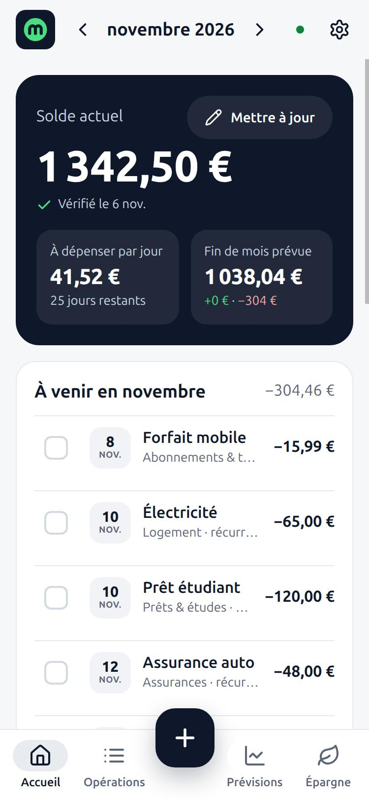
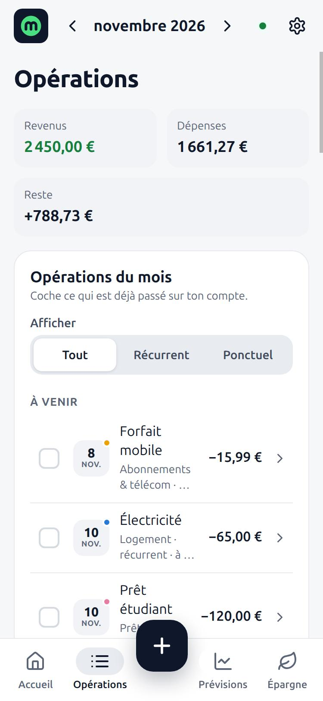
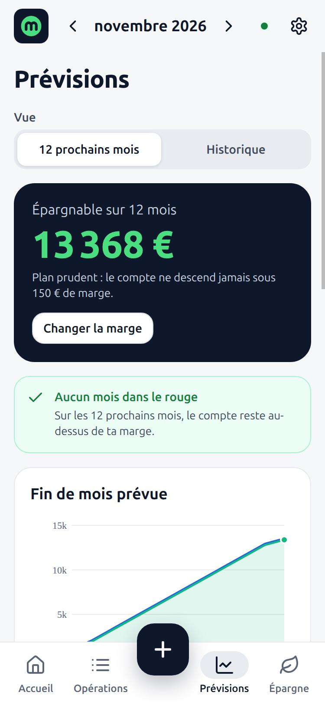
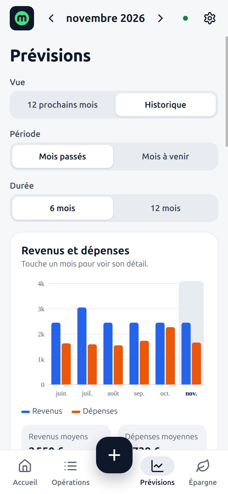
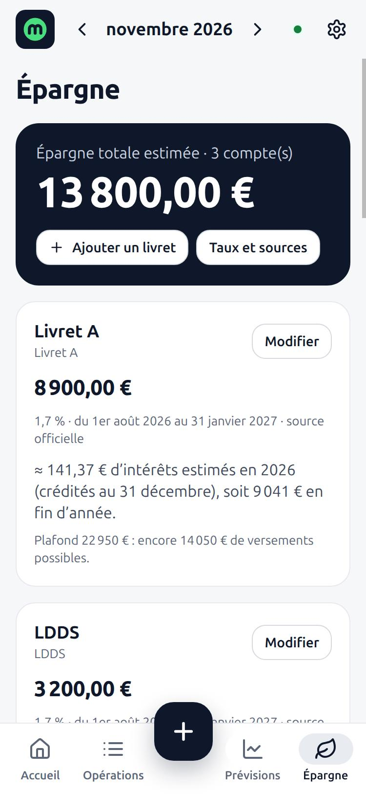
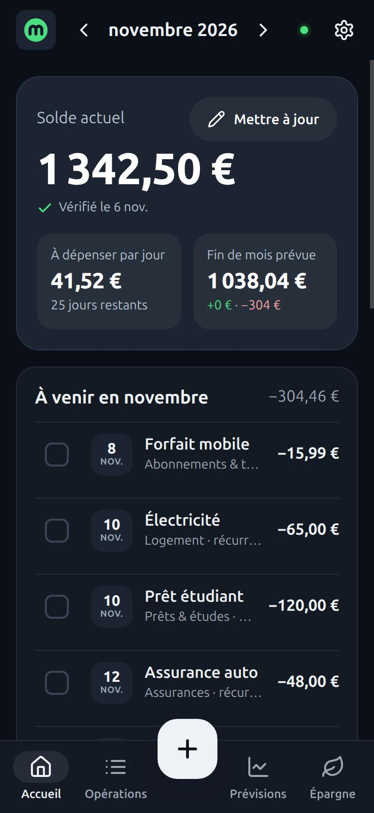
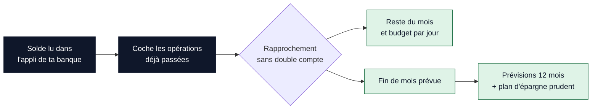
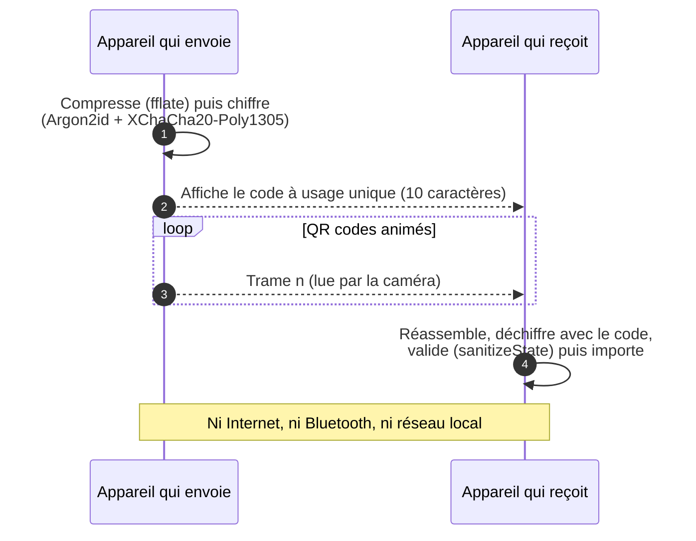
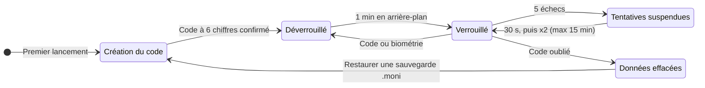
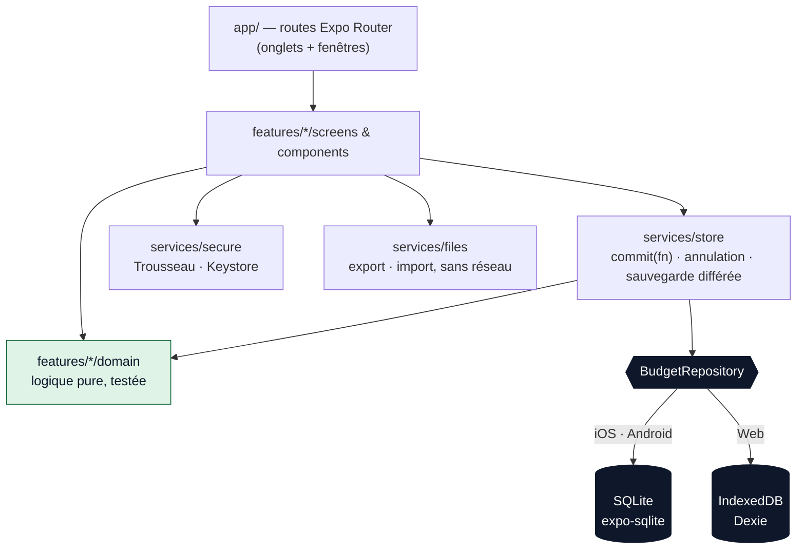

<p align="center">
  
</p>

<p align="center">
  <strong>Gestion de budget personnel, privée par conception.</strong><br />
  Pas de compte, pas de serveur, pas de traceur : tes données restent sur ton appareil.
</p>

<p align="center">
  <a href="#aperçu">Aperçu</a> ·
  <a href="#fonctionnalités-principales">Fonctionnalités</a> ·
  <a href="#2-mentions-légales">Mentions légales</a> ·
  <a href="#3-rôles-et-autorisations">Rôles</a> ·
  <a href="#4-guide-développeur">Démarrer</a>
</p>

<table align="center">
  <tr>
    <td align="center"><strong>Plateformes</strong><br />Web · Android · iOS</td>
    <td align="center"><strong>Stack</strong><br />Expo SDK 58 · React Native 0.88</td>
    <td align="center"><strong>Réseau</strong><br />0 appel à l'exécution</td>
    <td align="center"><strong>Licence</strong><br />PolyForm Noncommercial 1.0.0</td>
  </tr>
</table>

---

## Sommaire

1. [Présentation du projet](#1-présentation-du-projet)
   - [Concept](#concept)
   - [Aperçu](#aperçu)
   - [Objectifs](#objectifs)
   - [Fonctionnalités principales](#fonctionnalités-principales)
   - [Ce que Moni n'est pas](#ce-que-moni-nest-pas)
   - [Plateformes et état d'avancement](#plateformes-et-état-davancement)
2. [Mentions légales](#2-mentions-légales)
   - [Éditeur et droits d'auteur](#éditeur-et-droits-dauteur)
   - [Licence](#licence)
   - [Composants tiers](#composants-tiers)
   - [Politique de confidentialité](#politique-de-confidentialité)
   - [Limitation de responsabilité](#limitation-de-responsabilité)
   - [Droit applicable](#droit-applicable)
3. [Rôles et autorisations](#3-rôles-et-autorisations)
   - [Rôles sur le projet (code source)](#rôles-sur-le-projet-code-source)
   - [Matrice des droits sur le projet](#matrice-des-droits-sur-le-projet)
   - [Rôles dans l'application (données)](#rôles-dans-lapplication-données)
   - [Matrice des droits dans l'application](#matrice-des-droits-dans-lapplication)
   - [Permissions système demandées](#permissions-système-demandées)
4. [Guide développeur](#4-guide-développeur)
   - [Prérequis et installation](#prérequis-et-installation)
   - [Lancer l'application](#lancer-lapplication)
   - [Qualité](#qualité)
   - [Architecture](#architecture)
   - [Taux réglementés](#taux-réglementés)
   - [Builds avec EAS](#builds-avec-eas)
   - [Publication](#publication)
5. [Documentation complémentaire](#5-documentation-complémentaire)
6. [Contact](#6-contact)

---

## 1. Présentation du projet

### Concept

**Moni** est une application de **gestion de budget personnel** pour le **Web, Android et iOS**, pensée pour les
particuliers en France. On y saisit ses revenus, ses dépenses, son solde bancaire et son épargne ; Moni en déduit ce
qu'il reste à dépenser ce mois-ci, la fin de mois prévue et les douze mois à venir.

Son principe fondateur est la **confidentialité par conception** : l'application fonctionne **à 100 % en local**.
Il n'y a ni compte, ni serveur de données, ni publicité, ni mesure d'audience, ni rapport de plantage. Aucune
donnée de budget ne quitte l'appareil, sauf si l'utilisateur l'exporte lui-même.

Moni prend la suite d'une ancienne version en PHP : ses calculs ont été repris en TypeScript (parité vérifiée au
centime près) et l'interface a été entièrement réécrite avec React Native et Expo, sur une base de code unique.

<p align="center">
  
</p>

### Aperçu

<table>
  <tr>
    <td align="center" width="33%"><br /><sub><strong>Accueil</strong> · solde, budget du jour, fin de mois</sub></td>
    <td align="center" width="33%"><br /><sub><strong>Opérations</strong> · revenus, dépenses, reste</sub></td>
    <td align="center" width="33%"><br /><sub><strong>Prévisions</strong> · plan d'épargne prudent sur 12 mois</sub></td>
  </tr>
  <tr>
    <td align="center"><br /><sub><strong>Historique</strong> · revenus et dépenses mois par mois</sub></td>
    <td align="center"><br /><sub><strong>Épargne</strong> · livrets, taux sourcés, intérêts</sub></td>
    <td align="center"><br /><sub><strong>Thème sombre</strong> · automatique ou au choix</sub></td>
  </tr>
</table>

<sub>Captures de la version web avec des données fictives.</sub>

### Objectifs

| Objectif                              | Ce que cela implique                                                                               |
| ------------------------------------- | -------------------------------------------------------------------------------------------------- |
| **Savoir où on en est**               | Solde réel, reste du mois, montant à dépenser par jour, fin de mois prévue                         |
| **Anticiper**                         | Prévisions sur 12 mois et plan d'épargne qui ne descend jamais sous une marge de sécurité          |
| **Suivre son épargne**                | Livrets réglementés français, intérêts estimés selon la règle officielle des quinzaines, objectifs |
| **Garder la maîtrise de ses données** | Fonctionnement local, sauvegarde chiffrée, exports dans des formats ouverts                        |
| **Rester simple et accessible**       | Aucune connaissance financière requise, lecteurs d'écran pris en charge, thème clair ou sombre     |
| **Coûter presque rien**               | Pas de serveur applicatif à financer ni à maintenir                                                |

### Fonctionnalités principales

<p align="center">
  
</p>

#### Budget au quotidien

- **Lignes récurrentes** (revenus et dépenses) : jour du mois, fréquence mensuelle, bimestrielle, trimestrielle,
  semestrielle ou annuelle, mois de début et de fin.
- **Lignes « coupées »** : une ligne reste enregistrée sans être comptée, pour simuler « et si j'arrêtais ça ? ».
- **Modification à partir d'un mois donné** (hausse de loyer, augmentation…) : les mois passés restent exacts.
- **Opérations ponctuelles** datées, cochées automatiquement une fois leur date passée.
- **Dupliquer** une opération et **annuler** le dernier ajout, la dernière modification ou suppression.

#### Solde et tableau de bord

- **Rapprochement du solde** : l'utilisateur saisit le solde lu dans l'application de sa banque et coche les
  opérations déjà passées. Aucune opération n'est comptée deux fois et un éventuel écart est signalé.
- **Accueil** : reste du mois, montant disponible par jour, fin de mois prévue.
- **Prévisions sur 12 mois** et **plan d'épargne prudent**, réglé par une marge de sécurité.



#### Analyse

- **Historique et statistiques** sur 6 ou 12 mois : moyennes, tendance (comparaison avec les 3 mois précédents),
  dépenses par catégorie avec graphiques.
- **Catégories personnalisables** : nom, couleur, nature « besoin » ou « envie » (utilisée pour la règle 50/30/20).
  À la suppression, les opérations sont réaffectées.
- **Abonnements** : vue dédiée avec le coût lissé par mois et par an.
- **Repères** : mois dans le rouge, fins de contrat, coût total des abonnements, règle 50/30/20, épargne de
  précaution. Ce sont des informations générales, jamais un conseil en investissement.

#### Épargne

- **Livrets réglementés** : Livret A, LDDS, LEP, CEL, PEL (au taux de sa génération), Livret jeune (avec contrôle du
  plancher légal). Plafonds pris en compte.
- **Livrets bancaires** avec un taux saisi par l'utilisateur et un rappel de vérification après 6 mois.
- **Intérêts estimés selon la règle des quinzaines**, y compris lors d'un changement de taux en cours d'année.
- **Taux datés et sourcés** (Journal officiel, Service-Public.fr), embarqués dans l'application. Un taux n'est
  jamais inventé : une quinzaine sans taux connu est signalée comme telle.
- **Objectifs d'épargne** (montant visé, progression, délai estimé) et **simulateur** (versement mensuel et durée,
  au taux du Livret A comparé à un taux choisi).

#### Sécurité et données

- **Verrouillage de l'application** : code à 6 chiffres obligatoire au premier lancement, puis code ou biométrie
  (Face ID, empreinte). Nouveau verrouillage après une minute en arrière-plan.
- **Sauvegarde chiffrée `.moni`** (Argon2id + XChaCha20-Poly1305), phrase de passe d'au moins 10 caractères,
  rappel au bout de 30 jours.
- **Exports** JSON (toutes les données) et CSV (opérations, protégé contre l'injection de formules).
- **Import** d'une sauvegarde Moni, d'un export JSON ou d'un export de l'ancienne version PHP.
- **Transfert entre appareils par QR codes animés** : optique, chiffré, sans Internet, sans Bluetooth et sans
  réseau local.
- **Récupération automatique** : si les données sont illisibles, la dernière version saine est utilisée ; rien
  n'est jamais effacé implicitement.

#### Personnalisation

- Thème clair, sombre ou automatique, couleur d'accent, marge de sécurité.
- Pages « Confidentialité » et « Mentions légales » consultables dans l'application.
- **« Effacer toutes mes données »** depuis les réglages.

### Ce que Moni n'est pas

- **Pas une banque ni un agrégateur** : aucune connexion aux comptes bancaires (DSP2), aucune opération exécutée.
- **Pas un conseiller financier** : aucune recommandation de produit, aucun conseil en investissement.
- **Pas un outil comptable ou fiscal** : les calculs ne remplacent ni une comptabilité, ni l'avis d'un professionnel.

### Plateformes et état d'avancement

| Plateforme | Technologie                      | Stockage local       | État                                 |
| ---------- | -------------------------------- | -------------------- | ------------------------------------ |
| Web (PWA)  | React Native Web, service worker | IndexedDB (Dexie)    | Fonctionnelle, utilisable hors ligne |
| Android    | React Native 0.88, Expo SDK 58   | SQLite (expo-sqlite) | En préparation pour Google Play      |
| iOS        | React Native 0.88, Expo SDK 58   | SQLite (expo-sqlite) | En préparation pour l'App Store      |

Version actuelle : **1.0.0**. Langue de l'interface : français.

---

## 2. Mentions légales

> Cette section résume les documents de référence. En cas de divergence, les textes complets font foi :
> [LICENSE](LICENSE), [docs/LEGAL_NOTICE.md](docs/LEGAL_NOTICE.md) et [docs/PRIVACY_POLICY.md](docs/PRIVACY_POLICY.md).

### Éditeur et droits d'auteur

- **Éditeur** : Yoan Deloustal, à titre non professionnel (particulier), sans but lucratif.
- **Directeur de la publication** : Yoan Deloustal.
- **Contact** : yoandeloustal45@gmail.com
- **Hébergement de la version web** : à compléter avant la mise en ligne (voir [docs/LEGAL_NOTICE.md](docs/LEGAL_NOTICE.md)).
- **Distribution mobile** : Google Play (Google Ireland Limited) et App Store (Apple Distribution International Ltd.).

```
Required Notice: Copyright (c) 2026 Yoan Deloustal (yoandeloustal45@gmail.com)
```

Le nom **Moni**, le logo et les éléments graphiques de l'application sont la propriété de l'éditeur. La licence du
code ne confère aucun droit sur ces signes distinctifs.

### Licence

Le code source est publié sous la **[PolyForm Noncommercial License 1.0.0](LICENSE)**. Il s'agit d'une licence
« source disponible », et **non** d'une licence open source au sens de l'OSI.

| Usage                                                                                                  | Autorisé ?                                       |
| ------------------------------------------------------------------------------------------------------ | ------------------------------------------------ |
| Utiliser l'**application officielle** (stores, version web officielle), pour tout usage                | ✅ Oui, gratuitement, y compris professionnel    |
| Lire, étudier, exécuter le code à des fins personnelles, éducatives ou de recherche                    | ✅ Oui                                           |
| Modifier le code et redistribuer une version dérivée **à des fins non commerciales**                   | ✅ Oui, avec la licence et la `Required Notice`  |
| Usage par une association, un établissement d'enseignement, de recherche ou public                     | ✅ Oui, quelle que soit la source de financement |
| Vendre l'application, publier une version dérivée commerciale, intégrer le code dans un produit payant | ❌ Non, sauf accord écrit préalable de l'éditeur |
| Sous-licencier ou transférer la licence à un tiers                                                     | ❌ Non                                           |
| Utiliser le nom « Moni » ou le logo pour une version dérivée                                           | ❌ Non, sauf accord de l'éditeur                 |

Toute redistribution doit inclure le texte de la licence (ou son URL) et la ligne `Required Notice` ci-dessus.
Pour une utilisation commerciale du code : yoandeloustal45@gmail.com.

**Contributions** : en soumettant une contribution, tu acceptes qu'elle soit distribuée sous la licence du projet
et que Yoan Deloustal puisse l'utiliser, la modifier et la distribuer, y compris dans sa propre distribution de Moni.

### Composants tiers

Moni embarque des composants dont les licences autorisent l'usage commercial. Détail complet dans
[THIRD_PARTY_NOTICES.md](THIRD_PARTY_NOTICES.md).

| Composant                     | Usage                                         | Licence    |
| ----------------------------- | --------------------------------------------- | ---------- |
| Lucide (icônes)               | Formes des icônes (`src/components/Icon.tsx`) | ISC        |
| fflate                        | Compression des transferts par QR code        | MIT        |
| qrcode-generator              | Génération des QR codes                       | MIT        |
| jsQR                          | Lecture des QR codes sur le web               | Apache-2.0 |
| @noble/ciphers, @noble/hashes | Chiffrement (XChaCha20-Poly1305, Argon2id)    | MIT        |

Les textes de licence complets des dépendances npm sont fournis dans leurs paquets (`node_modules/<nom>/LICENSE`).

### Politique de confidentialité

**Moni ne collecte, ne reçoit et ne transmet aucune donnée.** Politique complète :
[docs/PRIVACY_POLICY.md](docs/PRIVACY_POLICY.md). Audit technique : [docs/NETWORK_AUDIT.md](docs/NETWORK_AUDIT.md).

| Donnée                                                           | Où elle est stockée                               | Qui y accède                                      |
| ---------------------------------------------------------------- | ------------------------------------------------- | ------------------------------------------------- |
| Revenus, dépenses, abonnements, catégories, remarques            | Uniquement sur l'appareil                         | L'utilisateur seul                                |
| Solde, livrets, mouvements, objectifs                            | Uniquement sur l'appareil                         | L'utilisateur seul                                |
| Préférences (thème, accent, durée de l'historique)               | Uniquement sur l'appareil                         | L'utilisateur seul                                |
| Empreinte du code de verrouillage (hachage salé, jamais le code) | Trousseau iOS / Keystore Android / espace du site | Le système, pour vérifier le code                 |
| Sauvegardes `.moni` (chiffrées)                                  | Là où l'utilisateur les enregistre                | Détenteur du fichier **et** de la phrase de passe |
| Exports JSON / CSV (non chiffrés)                                | Là où l'utilisateur les enregistre                | Toute personne ayant le fichier                   |

Garanties techniques :

- **Aucun appel réseau à l'exécution**, sur aucune plateforme. ESLint interdit `fetch`, `XMLHttpRequest`,
  `WebSocket` et `EventSource` ; la CI échoue en cas de régression.
- **Android** : la permission `INTERNET` est retirée des builds de production ; le système refuse donc toute
  connexion ouverte par l'application ou une bibliothèque.
- **iOS** : manifeste de confidentialité sans suivi ni donnée collectée (`NSPrivacyTracking: false`).
- **Web** : politique de sécurité du contenu `connect-src 'none'` ; polices, icônes et images servies par le site
  lui-même (aucun CDN).
- **Aucun SDK** d'analyse, de publicité ou de rapport de plantage ; aucune mise à jour à distance (OTA).
- **Biométrie** gérée entièrement par le système : Moni ne reçoit ni ne conserve aucune donnée biométrique.
- **Caméra** utilisée uniquement pendant le scan d'un transfert, avec l'accord de l'utilisateur ; aucune image n'est
  enregistrée, le micro n'est jamais demandé.

**Transfert entre appareils**, entièrement optique :



Les données peuvent être incluses dans la sauvegarde système du téléphone (Google / iCloud) selon les réglages de
l'utilisateur ; l'empreinte du code de verrouillage en est exclue. Pour exercer un recours : CNIL (www.cnil.fr).

**Déclarations des stores** : Google Play « Sécurité des données » : aucune donnée collectée, aucune donnée
partagée. App Store « Confidentialité de l'app » : Données non collectées.

### Limitation de responsabilité

- L'application et le code sont fournis **« en l'état »**, sans garantie de fonctionnement ininterrompu, d'absence
  d'erreur ou d'adéquation à un besoin particulier, dans les limites autorisées par la loi.
- Les résultats dépendent entièrement des informations saisies. Les **intérêts sont des estimations** et les taux
  réglementés sont ceux connus à la date de la version installée : ils peuvent avoir changé depuis.
- Les repères affichés (règle 50/30/20, épargne de précaution, simulateur) sont des **informations générales**, et
  jamais un conseil financier ou en investissement.
- L'éditeur ne peut être tenu responsable des décisions prises sur la base des calculs de l'application, ni d'une
  **perte de données**. L'utilisateur est seul responsable de ses sauvegardes : une désinstallation, un changement
  d'appareil ou un nettoyage du navigateur peut effacer les données.
- **Un code de verrouillage ou une phrase de passe oubliés ne peuvent pas être récupérés**, ni par l'éditeur ni par
  quiconque. En cas d'oubli du code, la seule solution est d'effacer les données puis de restaurer une sauvegarde.
- Cette limitation ne s'applique pas en cas de faute lourde ou intentionnelle de l'éditeur.

### Droit applicable

Les conditions d'utilisation sont régies par le **droit français**. En cas de difficulté, contacte d'abord l'éditeur
pour chercher une solution amiable ; à défaut, les tribunaux compétents sont ceux désignés par la loi.

---

## 3. Rôles et autorisations

Moni n'a **ni compte, ni serveur, ni administrateur** : il n'existe aucun rôle géré par l'application elle-même, et
l'éditeur n'a accès à aucune donnée d'utilisateur. Les droits se répartissent donc sur deux plans distincts :

- **le projet** : qui peut faire quoi sur le code source, le dépôt et les publications ;
- **l'application** : qui peut accéder à quoi, sur un appareil, en fonction de ce qu'il possède (l'appareil, le
  code, un fichier, une phrase de passe).

### Rôles sur le projet (code source)

| Rôle                             | Description                                                                                                    |
| -------------------------------- | -------------------------------------------------------------------------------------------------------------- |
| **Mainteneur / éditeur**         | Yoan Deloustal. Titulaire des droits d'auteur, responsable des publications, des taux et des documents légaux. |
| **Contributeur**                 | Toute personne qui propose une modification (issue, pull request).                                             |
| **Réutilisateur non commercial** | Personne ou organisation qui utilise, modifie ou redistribue le code dans le cadre de la licence.              |
| **Réutilisateur commercial**     | Personne ou entreprise qui souhaite exploiter le code commercialement. Nécessite un accord écrit.              |
| **Intégration continue (CI)**    | Workflow GitHub Actions automatisé, en lecture seule sur le dépôt (`permissions: contents: read`).             |

### Matrice des droits sur le projet

Légende : ✅ autorisé · ⚠️ sous conditions · ❌ interdit · — sans objet

| Action                                                             | Mainteneur | Contributeur | Réutilisateur non commercial | Réutilisateur commercial | CI  |
| ------------------------------------------------------------------ | :--------: | :----------: | :--------------------------: | :----------------------: | :-: |
| Lire et cloner le code                                             |     ✅     |      ✅      |              ✅              |            ✅            | ✅  |
| Exécuter et tester le code localement                              |     ✅     |      ✅      |              ✅              |           ⚠️ ¹           | ✅  |
| Ouvrir une issue ou une pull request                               |     ✅     |      ✅      |              ✅              |            ✅            |  —  |
| Pousser sur `main`, fusionner une pull request                     |     ✅     |      ❌      |              ❌              |            ❌            | ❌  |
| Modifier le code dans un fork                                      |     ✅     |      ✅      |              ✅              |           ⚠️ ¹           |  —  |
| Redistribuer une version modifiée                                  |     ✅     |     ⚠️ ²     |             ⚠️ ²             |           ⚠️ ¹           |  —  |
| Vendre ou exploiter commercialement le code                        |     ✅     |      ❌      |              ❌              |           ⚠️ ¹           |  —  |
| Utiliser le nom « Moni » et le logo                                |     ✅     |      ❌      |              ❌              |           ⚠️ ¹           |  —  |
| Mettre à jour les taux réglementés (`regulated.json`)              |     ✅     |     ⚠️ ³     |              —               |            —             | ❌  |
| Modifier les documents légaux (licence, mentions, confidentialité) |     ✅     |     ⚠️ ³     |              —               |            —             | ❌  |
| Ajouter une dépendance ou une permission système                   |     ✅     |     ⚠️ ⁴     |              —               |            —             | ❌  |
| Gérer les identifiants de signature (EAS, keystore, certificats)   |     ✅     |      ❌      |              ❌              |            ❌            | ❌  |
| Publier sur Google Play, l'App Store ou la version web officielle  |     ✅     |      ❌      |              ❌              |            ❌            | ❌  |
| Vérifier typage, lint, tests, fraîcheur des taux, build web        |     ✅     |      ✅      |              ✅              |            ✅            | ✅  |
| Accorder une licence commerciale ou une dérogation                 |     ✅     |      ❌      |              ❌              |            ❌            | ❌  |

1. Uniquement avec l'**accord écrit préalable** de l'éditeur.
2. À des fins **non commerciales**, avec le texte de la licence et la `Required Notice`, sous un autre nom que « Moni ».
3. Par **proposition** (pull request) soumise à la relecture du mainteneur ; pour les taux, la source officielle
   (arrêté au Journal officiel) doit être citée, voir [docs/RATES.md](docs/RATES.md).
4. Par proposition uniquement. Toute dépendance doit respecter la contrainte **zéro appel réseau** ; toute nouvelle
   permission doit être justifiée et documentée dans la politique de confidentialité.

**Règles imposées à toute contribution** :

- aucun appel réseau à l'exécution (ESLint et l'audit réseau le vérifient) ;
- montants en **centimes entiers** ;
- logique métier pure dans `src/features/*/domain` (sans React, sans horloge, sans stockage), testée ;
- persistance uniquement via l'interface `BudgetRepository` (`src/services/storage`) ;
- `npm run check` doit passer sans erreur ni avertissement.

### Rôles dans l'application (données)

Comme il n'y a pas de compte, l'accès aux données dépend uniquement de **ce que l'on possède** :

| Rôle                                   | Ce qu'il possède                                                          |
| -------------------------------------- | ------------------------------------------------------------------------- |
| **Utilisateur déverrouillé**           | L'appareil **et** le code à 6 chiffres (ou une biométrie enregistrée)     |
| **Détenteur de l'appareil verrouillé** | L'appareil, **sans** le code ni la biométrie                              |
| **Détenteur d'une sauvegarde `.moni`** | Le fichier `.moni`, avec ou sans la phrase de passe                       |
| **Détenteur d'un export JSON / CSV**   | Un fichier d'export non chiffré                                           |
| **Observateur d'un transfert QR**      | Les QR codes filmés ou photographiés, avec ou sans le code à usage unique |
| **Éditeur de Moni**                    | Rien : aucune donnée ne lui est jamais transmise                          |

### Matrice des droits dans l'application

| Action                                              | Utilisateur déverrouillé | Appareil verrouillé | `.moni` + phrase de passe | `.moni` seul | Export JSON / CSV | QR + code unique | QR seul | Éditeur |
| --------------------------------------------------- | :----------------------: | :-----------------: | :-----------------------: | :----------: | :---------------: | :--------------: | :-----: | :-----: |
| Consulter le budget, le solde, l'épargne            |            ✅            |         ❌          |           ✅ ¹            |      ❌      |       ✅ ²        |       ✅ ¹       |   ❌    |   ❌    |
| Ajouter, modifier, supprimer des opérations         |            ✅            |         ❌          |           ✅ ¹            |      ❌      |      ✅ ¹ ²       |       ✅ ¹       |   ❌    |   ❌    |
| Gérer catégories, livrets, objectifs                |            ✅            |         ❌          |           ✅ ¹            |      ❌      |      ✅ ¹ ²       |       ✅ ¹       |   ❌    |   ❌    |
| Modifier les réglages (thème, accent, marge)        |            ✅            |         ❌          |            ❌             |      ❌      |        ❌         |        ❌        |   ❌    |   ❌    |
| Changer le code, activer ou désactiver la biométrie |            ✅            |         ❌          |            ❌             |      ❌      |        ❌         |        ❌        |   ❌    |   ❌    |
| Créer une sauvegarde `.moni` ou un export           |            ✅            |         ❌          |           ✅ ¹            |      ❌      |       ✅ ¹        |       ✅ ¹       |   ❌    |   ❌    |
| Restaurer / importer des données                    |            ✅            |         ❌          |           ✅ ¹            |      ❌      |       ✅ ¹        |       ✅ ¹       |   ❌    |   ❌    |
| Envoyer ou recevoir un transfert QR                 |            ✅            |         ❌          |            ❌             |      ❌      |        ❌         |        ❌        |   ❌    |   ❌    |
| Effacer toutes les données de l'appareil            |            ✅            |        ⚠️ ³         |            ❌             |      ❌      |        ❌         |        ❌        |   ❌    |   ❌    |
| Récupérer un code ou une phrase de passe oubliés    |            ❌            |         ❌          |            ❌             |      ❌      |        ❌         |        ❌        |   ❌    |   ❌    |

1. En l'important dans **sa propre** installation de Moni (sur laquelle il est alors l'utilisateur déverrouillé).
2. Un export JSON / CSV **n'est pas chiffré** : il est lisible dans n'importe quel éditeur ou tableur. À conserver
   en lieu sûr.
3. Uniquement en effaçant **toutes** les données, sans pouvoir les lire : c'est la seule issue en cas de code
   oublié (désinstallation, suppression des données de l'application ou du site). Les données peuvent ensuite être
   restaurées depuis une sauvegarde `.moni`.

**Cycle de verrouillage** :



**Protections associées** :

- Le code n'est jamais stocké : seule une empreinte PBKDF2-SHA256 salée (50 000 itérations) est conservée dans le
  stockage sécurisé du système.
- Après 5 échecs, les tentatives sont refusées pendant 30 s, puis deux fois plus longtemps à chaque fois (jusqu'à
  15 min) ; les compteurs survivent au redémarrage.
- Le repli de la biométrie est le code de Moni, jamais le code de l'appareil.
- Rien de l'application n'est affiché avant le déverrouillage ; elle se reverrouille après une minute en arrière-plan.
- Sauvegardes et transferts sont chiffrés avec Argon2id + XChaCha20-Poly1305 ; le code de transfert (10 caractères)
  est à usage unique.

### Permissions système demandées

| Permission                                                                        | Plateforme   | Usage                               | Obligatoire ?                             |
| --------------------------------------------------------------------------------- | ------------ | ----------------------------------- | ----------------------------------------- |
| Biométrie (`USE_BIOMETRIC`, Face ID)                                              | Android, iOS | Déverrouiller l'application         | Non, le code suffit                       |
| Caméra (`CAMERA`)                                                                 | Toutes       | Scanner les QR codes d'un transfert | Non, seulement pour recevoir un transfert |
| Internet, localisation, micro, stockage, notifications, identifiant publicitaire… | Android      | —                                   | **Bloquées** en production                |

---

## 4. Guide développeur

### Prérequis et installation

- **Node.js 24 LTS** et npm
- Pour les builds natifs : un compte [Expo](https://expo.dev) et EAS CLI (`npx eas-cli@latest`), ou Android Studio /
  Xcode pour les builds locaux
- Facultatif : émulateur ou appareil Android, simulateur iOS (macOS uniquement)

```bash
npm ci
```

### Lancer l'application

| Plateforme | Commande                                       | Remarques                                                                     |
| ---------- | ---------------------------------------------- | ----------------------------------------------------------------------------- |
| Web        | `npm run web`                                  | Ouvre http://localhost:8081                                                   |
| Android    | `APP_VARIANT=development npx expo run:android` | Build de développement (Metro a besoin de `INTERNET`, conservé seulement ici) |
| iOS        | `APP_VARIANT=development npx expo run:ios`     | macOS et Xcode requis                                                         |

Test rapide sur un téléphone : `npx expo start --go`, puis scanner le QR code avec Expo Go (même réseau Wi-Fi).
Expo Go ignore le verrouillage des permissions d'`app.config.ts` : utiliser un build de développement ou `preview`
pour tester la configuration réelle.

Définir `EXPO_NO_TELEMETRY=1` pour désactiver les statistiques d'usage d'Expo CLI (déjà fait en CI et dans les
profils EAS).

### Qualité

```bash
npm run typecheck     # TypeScript (strict)
npm run lint          # ESLint + Prettier, aucun avertissement toléré
npm run test          # Jest + React Native Testing Library
npm run check         # tout ce qui précède + couverture + fraîcheur des taux
npx expo-doctor       # contrôle des dépendances et de la configuration
```

Les tests de stockage utilisent le vrai schéma SQL (`node:sqlite`) et le vrai code IndexedDB (`fake-indexeddb`),
migrations, récupération et persistance entre redémarrages comprises. La CI (GitHub Actions) exécute ces contrôles à
chaque push et pull request, ainsi que chaque lundi pour vérifier la fraîcheur des taux.

### Architecture

```
app/                     Routes (Expo Router) : (tabs)/ + fenêtres modales. Fines : elles réexportent les écrans.
src/
  features/<fonction>/
    domain/              Logique métier pure (sans React, horloge ni stockage) + tests unitaires
    forms/               Valeurs de formulaire ↔ entrées du domaine, validation (pure, testée)
    screens/ components/ Interface de la fonction
  services/
    storage/             Interface BudgetRepository
                         ├─ repository.native.ts  → SQLite (expo-sqlite), migrations versionnées (PRAGMA user_version)
                         └─ repository.web.ts     → IndexedDB (Dexie), schéma versionné
    store/               État : commit(fn) avec fonctions pures, annulation, enregistrements atomiques différés
    preferences/         Préférences simples (AsyncStorage / localStorage)
    files/               Export (partage / téléchargement) et import (sélecteur de fichiers), sans réseau
    pwa/                 Enregistrement du service worker (web, production uniquement)
    secure/              Stockage sécurisé : Trousseau / Keystore (expo-secure-store), localStorage sur le web
  components/            Composants accessibles réutilisables et graphiques SVG
  hooks/  theme/  types/  utils/
public/                  Web : modèle index.html, manifeste, icônes
scripts/                 build-pwa.mjs (service worker + CSP), check-rates.mjs, serve-dist.mjs
```



Règles clés :

1. **Les montants sont des centimes entiers** partout ; aucun calcul en euros flottants.
2. **`src/features/*/domain` est pur** : la date du jour est un paramètre, tout est testé. La parité avec l'algorithme
   PHP historique est vérifiée au centime près sur 300 budgets aléatoires.
3. **L'état ne change que via `commit(fn)`** avec une fonction pure : l'annulation est triviale et seules les lignes
   modifiées sont écrites, dans une transaction.
4. **Tout ce qui vient de l'extérieur est validé** (`sanitizeState`) : fichiers importés, données relues au
   démarrage, taux embarqués (`parseRatesFile`). Imports limités à 20 Mo.
5. **Rien n'est effacé implicitement.** Au démarrage, des données illisibles sont remplacées par le dernier
   instantané sain (3 conservés) ; sinon un écran propose de restaurer une sauvegarde. Des données écrites par une
   version plus récente ne sont jamais ouvertes.

#### Évolution du schéma de données

- Natif : ajouter une migration dans `src/services/storage/sqlite/migrations.ts` (ne jamais modifier une migration publiée).
- Web : ajouter `this.version(n + 1).stores(...).upgrade(...)` dans `src/services/storage/indexedDbRepository.ts`.
- Format de sauvegarde / export : incrémenter `SCHEMA_VERSION` dans `src/types/domain.ts` et convertir les anciennes
  données dans `sanitizeState`.
- Ajouter un test pour chaque migration.

### Taux réglementés

Les taux sont embarqués dans `src/features/savings/data/regulated.json`, chacun avec sa période de validité et sa
source. Ils sont révisés deux fois par an : voir [docs/RATES.md](docs/RATES.md). `npm run rates:check` (lancé chaque
semaine par la CI) échoue quand une révision attendue est dépassée.

### Builds avec EAS

| Profil        | Rôle                                                                                       | Sortie                       |
| ------------- | ------------------------------------------------------------------------------------------ | ---------------------------- |
| `development` | Build de debug chargeant le JS depuis Metro (`APP_VARIANT=development`, `fr.moni.app.dev`) | APK Android / simulateur iOS |
| `preview`     | Test interne de la configuration de production                                             | APK Android, iOS ad hoc      |
| `production`  | Publication sur les stores (numéros de build auto-incrémentés)                             | AAB Android, IPA iOS         |

```bash
npx eas-cli@latest login
npx eas-cli@latest init                       # lie le projet, écrit extra.eas.projectId
npx eas-cli@latest build --profile preview --platform android
npx eas-cli@latest build --profile production --platform all
```

EAS gère les identifiants de signature (keystore Android, certificats et profils iOS). **Ne jamais committer de
keystore, de certificat ni de fichier `.env`** (ils sont ignorés par git).

### Publication

#### Google Play

1. Créer un compte développeur Google Play et l'application (`fr.moni.app`, définitif une fois publié).
2. Premier envoi : `eas build --profile production --platform android`, puis téléverser le `.aab` dans la Play
   Console (ou `eas submit --platform android` une fois une clé de compte de service configurée dans EAS).
3. Fiche : description, captures (téléphone, tablettes 7" et 10"), icône 512×512, bannière 1024×500.
4. **Sécurité des données** : « Aucune donnée collectée », « Aucune donnée partagée ». URL de la politique de
   confidentialité : héberger `docs/PRIVACY_POLICY.md`.
5. Comptes personnels : test fermé avec au moins 12 testeurs pendant 14 jours avant la production.

#### App Store

1. Adhésion à l'Apple Developer Program, puis création de l'application dans App Store Connect (`fr.moni.app`).
2. `eas build --profile production --platform ios`, puis `eas submit --platform ios`.
3. **Confidentialité de l'app** : « Données non collectées ». URL de la politique de confidentialité requise.
4. Conformité à l'export : l'application chiffre les sauvegardes de l'utilisateur avec des algorithmes standards ;
   répondre en conséquence dans App Store Connect (puis définir `ios.config.usesNonExemptEncryption` dans
   `app.config.ts`).
5. Captures : iPhone 6,9" et 6,5", iPad 13".

#### Web (hébergement statique)

```bash
npm run build:web         # expo export --platform web + service worker + CSP → dist/
npm run serve:web         # vérification locale sur http://localhost:8090
```

Déployer le contenu de `dist/` sur n'importe quel hébergeur statique (nginx, Caddy, Netlify, GitHub Pages…), avec :

- un repli SPA vers `/index.html` ;
- `Cache-Control: no-cache` sur `index.html` et `sw.js`, cache longue durée sur `/_expo/static/*` ;
- HTTPS (requis pour le service worker et le stockage persistant).

Exemple de configuration nginx :

```nginx
server {
  listen 443 ssl http2;
  server_name moni.example;
  root /var/www/moni/current;
  access_log off;

  add_header Content-Security-Policy "default-src 'self'; script-src 'self'; style-src 'self' 'unsafe-inline'; img-src 'self' data: blob:; font-src 'self' data:; connect-src 'none'; worker-src 'self'; manifest-src 'self'; object-src 'none'; base-uri 'self'; form-action 'none'; frame-ancestors 'none'" always;
  add_header X-Content-Type-Options nosniff always;
  add_header Referrer-Policy no-referrer always;
  add_header Permissions-Policy "camera=(self), microphone=(), geolocation=()" always;

  location = /sw.js { add_header Cache-Control "no-cache"; }
  location = /index.html { add_header Cache-Control "no-cache"; }
  location /_expo/static/ { add_header Cache-Control "public, max-age=31536000, immutable"; }
  location / { try_files $uri /index.html; }
}
```

Conserver un dossier par version et pointer `current` dessus avec un lien symbolique permet un retour arrière
instantané.

---

## 5. Documentation complémentaire

| Document                                                 | Contenu                                                  |
| -------------------------------------------------------- | -------------------------------------------------------- |
| [LICENSE](LICENSE)                                       | Texte complet de la PolyForm Noncommercial License 1.0.0 |
| [THIRD_PARTY_NOTICES.md](THIRD_PARTY_NOTICES.md)         | Licences des composants tiers embarqués                  |
| [docs/LEGAL_NOTICE.md](docs/LEGAL_NOTICE.md)             | Mentions légales et conditions d'utilisation             |
| [docs/PRIVACY_POLICY.md](docs/PRIVACY_POLICY.md)         | Politique de confidentialité                             |
| [docs/NETWORK_AUDIT.md](docs/NETWORK_AUDIT.md)           | Audit « zéro appel réseau »                              |
| [docs/RATES.md](docs/RATES.md)                           | Procédure de mise à jour des taux réglementés            |
| [docs/CAHIER_DES_CHARGES.md](docs/CAHIER_DES_CHARGES.md) | Cahier des charges fonctionnel                           |

## 6. Contact

- **Questions, licence commerciale, signalement d'un problème de sécurité** : yoandeloustal45@gmail.com
- **Bugs et suggestions** : [issues du dépôt GitHub](https://github.com/ydeloustal/moni/issues)

L'adresse e-mail et le contenu d'un message servent uniquement à y répondre.

---

<p align="center">
  <br />
  <sub>Copyright © 2026 Yoan Deloustal · PolyForm Noncommercial 1.0.0</sub>
</p>
